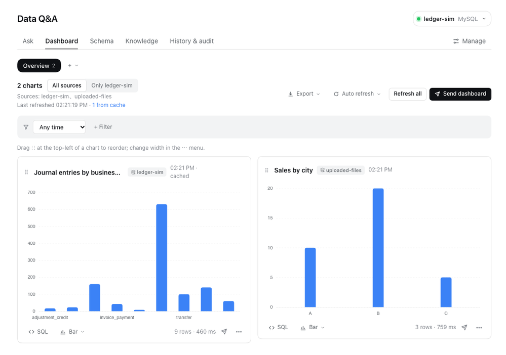
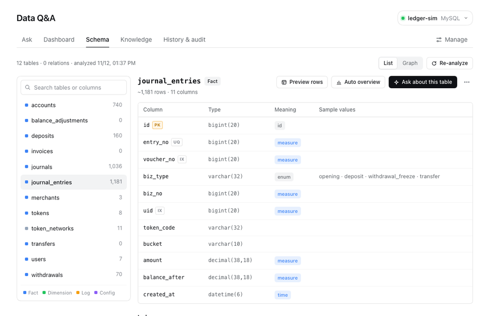
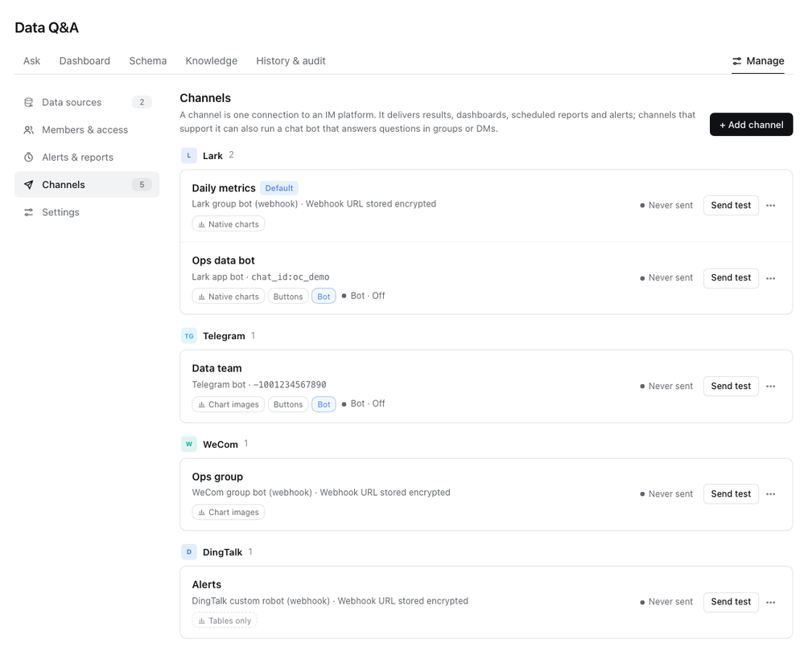

<div align="center">

# dsh-nl2sql

**Ask your databases in plain language — inside [DeepSeek Harness](https://github.com/deepseek-ai).**

The agent writes read-only SQL, runs it and charts the answer in the conversation.<br>
Pin results to dashboards, schedule reports and alerts, and push them to Lark / Feishu, Telegram, WeCom or DingTalk — or let teammates @-mention a bot in their group chat.

[](https://www.npmjs.com/package/@hedeqiang/dsh-nl2sql)
[](https://github.com/hedeqiang/dsh-nl2sql/actions/workflows/check.yml)
[](LICENSE)

English · [简体中文](README.zh-CN.md)

</div>



## Contents

- [Features](#features)
- [Requirements](#requirements)
- [Installation](#installation)
- [Quick start](#quick-start)
- [IM channels and bots](#im-channels-and-bots)
- [Security model](#security-model)
- [Data and privacy](#data-and-privacy)
- [Limitations](#limitations)
- [Development](#development)
- [Contributing](#contributing)
- [License](#license)

## Features

**Ask and analyze**
- Data sources: MySQL 5.7+, PostgreSQL, Elasticsearch (SQL), optionally through an SSH tunnel, and CSV / Excel uploads stored as local SQLite.
- Schema analysis: table roles, column semantics (time / measure / enum / sensitive), inferred relations and an ER graph.
- Natural-language questions in any Harness conversation through the `nl2sql_*` agent tools; results render as interactive ECharts charts or tables.
- Drill-down: split by a dimension, show the rows behind a point, and *why did it change* — rank dimensions by their contribution between two periods.
- Business knowledge: glossary, governed metrics (queried with `nl2sql_metric`), column notes and verified question → SQL examples, with import / export and suggestions mined from history and feedback.
- Accuracy evaluation: replay the verified examples, or let the agent answer them from scratch and compare results.

**Share and automate**
- Multiple dashboards with global filters, drag-to-reorder, three widths, snapshots and Excel export. A dashboard may mix data sources; every chart shows where it comes from.
- Scheduled reports, metric alerts (threshold / change / anomaly / missing data) and schema change detection.
- Push to Lark / Feishu, Telegram, WeCom and DingTalk; charts are sent as native card charts, images or tables depending on the platform, and large results come with the full data as an Excel attachment where the platform allows files.
- Chat bots that answer @-mentions in group chats without a public URL (Lark long connection, Telegram long polling, WeCom AI bot long connection, DingTalk Stream mode).

**Govern**
- Read-only by construction, table / column access policies with masking, and a full-scan guard.
- Members with roles (admin / analyst / viewer), data source scopes and row-level rules for people and group chats on every IM platform.
- Audit history attributed to people, and a setting for exactly what query data the model may see.

<table>
<tr>
<td width="50%"></td>
<td width="50%"></td>
</tr>
<tr>
<td align="center"><sub>Schema analysis</sub></td>
<td align="center"><sub>IM channels</sub></td>
</tr>
</table>

## Requirements

- [DeepSeek Harness](https://github.com/deepseek-ai) 0.2 or later — the desktop app or `dsh web`.
- Network access from the Harness machine to your databases (directly or through SSH).
- A **read-only database account** is strongly recommended (see [Security model](#security-model)).

## Installation

**From the Harness UI (recommended)**

1. Open **Plugins** in the sidebar and choose **Add plugin**.
2. Enter `@hedeqiang/dsh-nl2sql` (optionally pinned, e.g. `@hedeqiang/dsh-nl2sql@0.11.2`), then install and enable it.
3. **Data Q&A** appears in the sidebar, and a *Data Q&A* agent preset is available for new conversations.

You can also simply ask the Harness agent: *"install the plugin @hedeqiang/dsh-nl2sql"*.

**From the command line**

```bash
dsh plugin --profile desktop add @hedeqiang/dsh-nl2sql   # the desktop app uses the "desktop" profile; dsh web uses "web"
```

Then enable it on the **Plugins** page, or restart Harness.

**Upgrade and uninstall**

```bash
dsh plugin --profile desktop update @hedeqiang/dsh-nl2sql
dsh plugin --profile desktop remove @hedeqiang/dsh-nl2sql
```

Configuration and data live in `~/.dsh/nl2sql` and survive upgrades and uninstalls; older configuration is migrated automatically on first load. Delete the directory yourself if you no longer need it.

All dependencies ship prebuilt binaries, so no install scripts need to run.

## Quick start

1. **Data Q&A → Manage → Data sources** — add a database, or upload a CSV / Excel file.
2. **Schema** — run the analysis (it reads metadata and a small sample of enum values, never full tables).
3. **Ask** — type a question, e.g. *"daily orders and revenue over the last 30 days"*. The agent picks tables, writes SQL for your dialect, runs it and draws a chart. You can also choose the *Data Q&A* preset in any conversation.
4. **Dashboard** — pin useful charts, add filters, export or send them.
5. **Knowledge** — add glossary terms, metric definitions and verified examples to make answers consistent; run an evaluation to measure accuracy.

## IM channels and bots

Every platform is an adapter under [`channels/`](channels); the core only talks to the adapter interface described in [docs/channels.md](docs/channels.md).

| Platform | Push | Charts | Buttons | Bot without public URL |
|---|---|---|---|---|
| Lark / Feishu — group webhook | ✓ | native card charts | – | – |
| Lark / Feishu — app bot | ✓ (+ Excel attachment) | native charts or images | ✓ | ✓ long connection |
| Telegram | ✓ (+ Excel attachment) | images | ✓ inline keyboard | ✓ long polling |
| WeCom — group webhook | ✓ | images | – | – |
| WeCom — AI bot | ✓ (chats that messaged the bot) | tables | – | ✓ long connection |
| DingTalk — custom robot | ✓ (optional signing) | tables | – | – |
| DingTalk — internal app robot | ✓ | tables | – | ✓ Stream mode |

Add a channel in **Manage → Channels**: pick the platform and connection type, and the form shows the console steps for that platform. People and groups are granted access in **Manage → Members & access**; anyone who has talked to a bot can be added with one click.

In a group chat, members @-mention the bot and ask. The bot knows which data sources the member may use and picks the matching one. Chat commands: `help`, `数据源` (list sources), `切换 <name>` (pin a source), `自动` (pick automatically again), `新对话` / `reset` (new conversation).

> The Telegram, WeCom and DingTalk adapters are tested against local fakes of their APIs and have not yet been verified with real accounts; Lark has been used with real workspaces. Reports from real deployments are welcome.

## Security model

- **Read-only queries.** Every statement passes a per-dialect lexer (MySQL, PostgreSQL, SQLite, Elasticsearch SQL) that admits only `SELECT` / `SHOW` / `DESCRIBE` / `EXPLAIN`; queries run in read-only transactions with server-side timeouts, PostgreSQL uses the extended protocol (no multi-statement strings), and large results are streamed and truncated.
- **Access policies.** Allow or deny tables, hide or mask columns, and refuse full scans of large tables unless confirmed.
- **Members.** Data source scopes, a viewer role (metric library, verified examples and dashboards only) and row-level rules that are injected into queries — queries that cannot be rewritten safely are refused.
- **Bot actions.** Buttons on IM messages carry opaque tokens only; every click is re-authorized for the person who clicked.

The lexer is a first line of defence, not a substitute for database permissions: **always connect with a read-only account.** See [SECURITY.md](SECURITY.md) to report a vulnerability.

## Data and privacy

| What | Where |
|---|---|
| Configuration (data sources, dashboards, knowledge, alerts, members, channels, settings) | `~/.dsh/nl2sql/state.json` |
| Query results, cache, snapshots and logs (history, audit, feedback, deliveries, alerts) | `~/.dsh/nl2sql/results.sqlite` |
| Uploaded files | `~/.dsh/nl2sql/files/` |
| Database passwords, SSH keys, bot secrets | the Harness credential store |

**Settings → Data shown to the model** controls what query data reaches the LLM: nothing, per-column statistics (default) or the first *N* rows. Sensitive columns are masked by default. Anything you push to an IM platform leaves your machine.

## Limitations

- Alerts and the daily schema check run inside the Harness process: nothing is checked while Harness is closed; one catch-up run happens after it starts.
- The local page has owner rights and no login; do not expose the Harness web port to untrusted networks.
- Row-level rules apply to IM members; queries with subqueries, CTEs or `UNION` are refused under row-level rules.
- Legacy `.xls` files are not supported (use `.xlsx` or CSV).

## Development

```bash
git clone https://github.com/hedeqiang/dsh-nl2sql.git
cd dsh-nl2sql
pnpm install --ignore-scripts
npm test                        # full suite; local MySQL / PostgreSQL are used when available
npm run test:fast               # unit + UI tests only
node scripts/build-client.mjs   # regenerate lib/client.js after editing client-src/
```

Install your checkout as a linked plugin with **Plugins → Add plugin** and the absolute directory path; re-enable the plugin to load changes. Project layout, conventions and test setup are in [docs/development.md](docs/development.md); an isolated accuracy benchmark lives in [eval/](eval/README.md).

## Contributing

Issues and pull requests are welcome — please read [CONTRIBUTING.md](CONTRIBUTING.md) and follow the [Code of Conduct](CODE_OF_CONDUCT.md). Release notes are in [CHANGELOG.md](CHANGELOG.md).

## License

[MIT](LICENSE) © hedeqiang
