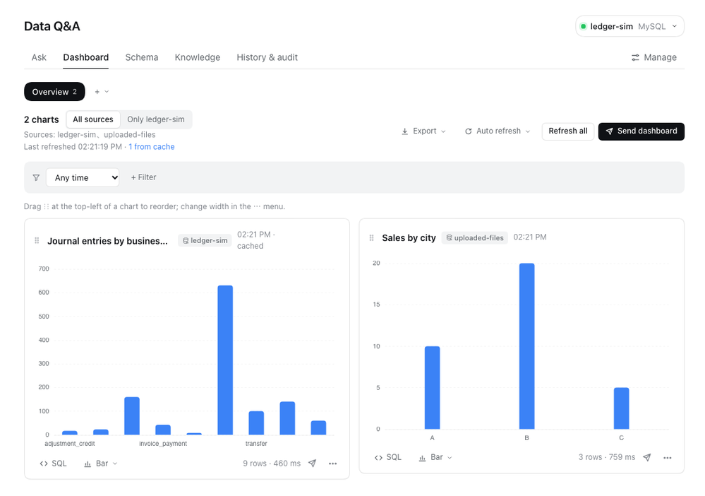
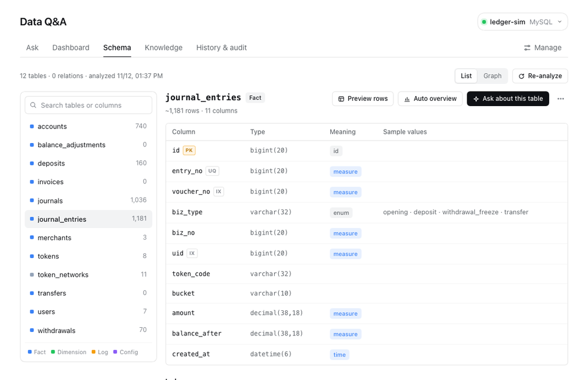
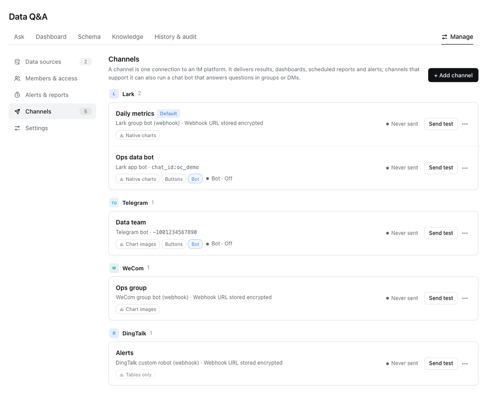

<div align="center">

# dsh-nl2sql

**在 [DeepSeek Harness](https://github.com/deepseek-ai) 里用自然语言问数据库。**

Agent 编写只读 SQL、执行并在对话中画图。<br>
结果可以固定到看板、定时报告和告警，推送到飞书、Telegram、企业微信、钉钉，也可以让同事在群里直接 @机器人 提问。

[](https://www.npmjs.com/package/@hedeqiang/dsh-nl2sql)
[](https://github.com/hedeqiang/dsh-nl2sql/actions/workflows/check.yml)
[](LICENSE)

[English](README.md) · 简体中文

</div>



## 目录

- [功能](#功能)
- [环境要求](#环境要求)
- [安装](#安装)
- [快速开始](#快速开始)
- [IM 渠道与机器人](#im-渠道与机器人)
- [MCP 服务](#mcp-服务)
- [安全模型](#安全模型)
- [数据与隐私](#数据与隐私)
- [已知限制](#已知限制)
- [开发](#开发)
- [参与贡献](#参与贡献)
- [许可证](#许可证)

## 功能

**提问与分析**
- 数据源：MySQL 5.7+、PostgreSQL、Elasticsearch（SQL），可经 SSH 隧道；也可以上传 CSV / Excel，保存为本机 SQLite。
- 表结构分析：识别表的角色、字段语义（时间 / 度量 / 枚举 / 敏感），推断表间关系，提供关系图。
- 在任意 Harness 对话中用自然语言提问，Agent 通过 `nl2sql_*` 工具查询，结果渲染为可交互的 ECharts 图表或表格。
- 下钻：按维度拆分、查看某个点的明细，以及「为什么变化」——比较两个时段并按维度贡献排序。
- 业务知识：词表、指标口径（`nl2sql_metric` 按口径查询）、字段备注、已验证的问题 → SQL 样例；支持导入导出，并能从历史和反馈中自动生成建议。
- 准确率评测：回放样例，或让 Agent 从零作答后与样例结果比对。

**共享与自动化**
- 多看板、全局筛选、拖拽排序、三档宽度、快照、Excel 导出；一个看板可以放多个数据源的图表，每个图表标注来源。
- 定时报告、指标告警（阈值 / 环比 / 异常 / 无数据）、表结构变更检测。
- 推送到飞书、Telegram、企业微信、钉钉：图表按平台能力用原生卡片图表、图片或表格发送；结果过大时，在能发文件的平台附带完整数据 Excel。
- 群聊机器人回答 @提问，不需要公网地址（飞书长连接、Telegram 长轮询、企业微信智能机器人长连接、钉钉 Stream 模式）。

**让数据找人**
- 数据新鲜度：记录每张表的最新数据时间，回答近期数据时提示是否滞后，数据断更时告警；每日数据质量巡检并给出健康分。
- 跨数据源对账：按主键对比两个数据源的两条查询，列出单边缺失和数值差异；可保存为每日任务，有差异时推送并附 Excel。
- 群里订阅：「@机器人 每天 9 点把这个发到群里」「提现超过 50 万提醒我」直接创建订阅或告警，推送到当前群。
- 每日数据简报（异常变化及主要来源）、告警消息自动归因、指标目标进度与达成预测、时间序列预测。

**展示与集成**
- 看板或结果导出 PPT、长图（可发送到飞书 / Telegram）；大屏模式（全屏、自动刷新、轮播）。
- 定时把查询结果同步到飞书多维表格。
- MCP 服务：Claude Desktop、Cursor、VS Code 等 MCP 客户端可以使用同样受控的数据访问（见 [docs/mcp.md](docs/mcp.md)）。

**治理**
- 只读执行；表 / 字段级访问控制与脱敏；大表全表扫描保护。
- 成员：各 IM 平台的个人和群都可以设置角色（管理员 / 分析师 / 只读）、数据源范围和行级权限。
- 审计记录归属到具体的人；可以精确设置哪些查询数据会发给模型。

<table>
<tr>
<td width="50%"></td>
<td width="50%"></td>
</tr>
<tr>
<td align="center"><sub>表结构分析</sub></td>
<td align="center"><sub>IM 渠道</sub></td>
</tr>
</table>

## 环境要求

- [DeepSeek Harness](https://github.com/deepseek-ai) 0.2 及以上（桌面版或 `dsh web`）。
- Harness 所在机器能访问数据库（直连或经 SSH）。
- 强烈建议使用**只读数据库账号**（见[安全模型](#安全模型)）。

## 安装

**在 Harness 界面中安装（推荐）**

1. 左侧栏打开 **插件**，选择 **添加插件**。
2. 输入 `@hedeqiang/dsh-nl2sql`（可指定版本，如 `@hedeqiang/dsh-nl2sql@0.11.2`），安装并启用。
3. 左侧栏出现 **数据问答**，新建对话时也可以选择「数据问答」预设。

也可以直接对 Harness 的 Agent 说：「安装插件 @hedeqiang/dsh-nl2sql」。

**命令行**

```bash
dsh plugin --profile desktop add @hedeqiang/dsh-nl2sql   # 桌面版的 profile 是 desktop；dsh web 默认是 web
```

然后在 **插件** 页启用，或重启 Harness。

**升级与卸载**

```bash
dsh plugin --profile desktop update @hedeqiang/dsh-nl2sql
dsh plugin --profile desktop remove @hedeqiang/dsh-nl2sql
```

配置和数据保存在 `~/.dsh/nl2sql`，升级、卸载都不会删除；旧版本的配置会在首次加载时自动迁移。不再需要时请手动删除该目录。

所有依赖都提供预编译包，安装时不需要运行构建脚本。

## 快速开始

1. **数据问答 → 管理 → 数据源**：添加数据库，或上传 CSV / Excel。
2. **表结构**：运行分析（只读取元数据和少量枚举取值样本，不会扫描整表）。
3. **问答**：输入问题，例如「最近 30 天每天的订单量和金额」。Agent 选择表、按方言编写 SQL、执行并画图。也可以在任意对话中选择「数据问答」预设。
4. **看板**：固定有用的图表，添加筛选，导出或发送。
5. **业务知识**：补充词表、指标口径和已验证样例，让回答口径一致；运行评测衡量准确率。

## IM 渠道与机器人

每个平台都是 [`channels/`](channels) 下的一个适配器，核心逻辑只依赖 [docs/channels.md](docs/channels.md) 中定义的接口。

| 平台 | 推送 | 图表 | 无需公网地址的机器人 |
|---|---|---|---|
| 飞书 — 群机器人（Webhook） | ✓ | 原生卡片图表 | – |
| 飞书 — 应用机器人 | ✓（附带 Excel） | 原生图表或图片 | ✓ 长连接 |
| Telegram | ✓（附带 Excel） | 图片 | ✓ 长轮询 |
| 企业微信 — 群机器人 | ✓ | 图片 | – |
| 企业微信 — 智能机器人 | ✓（仅已给机器人发过消息的会话） | 表格 | ✓ 长连接 |
| 钉钉 — 自定义机器人 | ✓（支持加签） | 表格 | – |
| 钉钉 — 企业内部应用机器人 | ✓ | 表格 | ✓ Stream 模式 |

在 **管理 → 渠道** 添加渠道：选择平台和接入方式，表单会显示该平台开放平台的配置步骤。在 **管理 → 成员与权限** 给个人和群开通权限，和机器人说过话的人或群可以一键添加。

群成员 @机器人 直接提问。机器人知道该成员能用哪些数据源，并自动选择匹配的那个。群内命令：`帮助`、`数据源`（列出可用数据源）、`切换 <名称>`（固定数据源）、`自动`（恢复自动选择）、`新对话`。

> Telegram、企业微信、钉钉适配器目前只在本地模拟的平台接口上测试过，尚未在真实账号上验证；飞书已在真实环境中使用。欢迎反馈实际部署情况。

## MCP 服务

Claude Desktop、Cursor、Cline、VS Code 等 AI 工具可以通过 [Model Context Protocol](https://modelcontextprotocol.io/) 查询这里的数据源，只读准入、访问控制、成员范围、行级权限、隐私设置与审计同样生效。在 **管理 → MCP 接入** 中启用（默认关闭，只监听 `127.0.0.1:47860`），创建带权限范围的令牌（只显示一次），把页面生成的配置粘贴到客户端即可。HTTP 客户端使用 `http://127.0.0.1:47860/mcp` 并带上 `Authorization: Bearer <令牌>`；Claude Desktop 等 stdio 客户端使用内置的桥接命令：

```bash
NL2SQL_MCP_TOKEN=<令牌> npx -y -p @hedeqiang/dsh-nl2sql nl2sql-mcp
```

工具：`list_datasources`、`get_schema`、`query`、`query_metric`、`search_knowledge`、`drill`、`explain_change`（安装了对账 / 预测功能时还有 `reconcile` / `forecast`）；资源：每个可见数据源的表结构。详见 [docs/mcp.md](docs/mcp.md)（英文）。

## 安全模型

- **只读查询。** 每条语句都经过按方言的词法检查（MySQL、PostgreSQL、SQLite、Elasticsearch SQL），只允许 `SELECT` / `SHOW` / `DESCRIBE` / `EXPLAIN`；查询在只读事务中执行并有服务端超时；PostgreSQL 使用扩展协议（不接受多语句）；大结果流式读取并截断。
- **访问控制。** 允许或排除表、隐藏或脱敏字段；大表全表扫描需要确认。
- **成员。** 数据源范围、只读角色（只能用指标库、已验证样例和看板），以及自动注入查询的行级权限——无法安全改写的查询直接拒绝。
- **机器人回复。** IM 回复只包含结论和数据，不带按钮；拆分、为什么变化、明细、固定到看板等后续分析在 Harness 对话中进行。

词法检查只是第一道防线，不能替代数据库权限：**请始终使用只读账号连接。** 安全问题的报告方式见 [SECURITY.md](SECURITY.md)。

## 数据与隐私

| 内容 | 位置 |
|---|---|
| 配置（数据源、看板、业务知识、告警、成员、渠道、设置） | `~/.dsh/nl2sql/state.json` |
| 查询结果、缓存、快照和日志（历史、审计、反馈、推送记录、告警记录） | `~/.dsh/nl2sql/results.sqlite` |
| 上传的文件 | `~/.dsh/nl2sql/files/` |
| 数据库密码、SSH 密钥、机器人密钥 | Harness 凭据库 |

**设置 → 模型可见数据** 决定哪些查询数据会发给大模型：不发、按列统计摘要（默认；时间序列另含首末值与变化，每个数值列另含最高、最低所在的行标签）或前 *N* 行。模型会被告知自己能看到哪一种，不会编造没给它的数字。敏感字段默认脱敏。推送到 IM 平台的内容会离开本机。

## 已知限制

- 告警和每日表结构检查在 Harness 进程内运行：Harness 关闭期间不检查，启动后补查一次。
- 本机页面拥有所有者权限，没有登录机制；不要把 Harness Web 端口暴露到不可信网络。
- 行级权限作用于 IM 成员；在行级权限下，含子查询、CTE 或 `UNION` 的查询会被拒绝。
- 不支持旧版 `.xls`（请使用 `.xlsx` 或 CSV）。

## 开发

```bash
git clone https://github.com/hedeqiang/dsh-nl2sql.git
cd dsh-nl2sql
pnpm install --ignore-scripts
npm test                        # 全部测试；本机有 MySQL / PostgreSQL 时会用到
npm run test:fast               # 只跑单元测试和界面测试
node scripts/build-client.mjs   # 修改 client-src/ 后重新生成 lib/client.js
```

在 **插件 → 添加插件** 中填入本目录的绝对路径即可以链接方式安装，改代码后重新启用插件生效。目录结构、约定和测试说明见 [docs/development.md](docs/development.md)；隔离的准确率评测环境见 [eval/](eval/README.md)。

## 参与贡献

欢迎提交 Issue 和 Pull Request，请先阅读 [CONTRIBUTING.md](CONTRIBUTING.md) 并遵守[行为准则](CODE_OF_CONDUCT.md)。版本说明见 [CHANGELOG.md](CHANGELOG.md)。

## 许可证

[MIT](LICENSE) © hedeqiang
